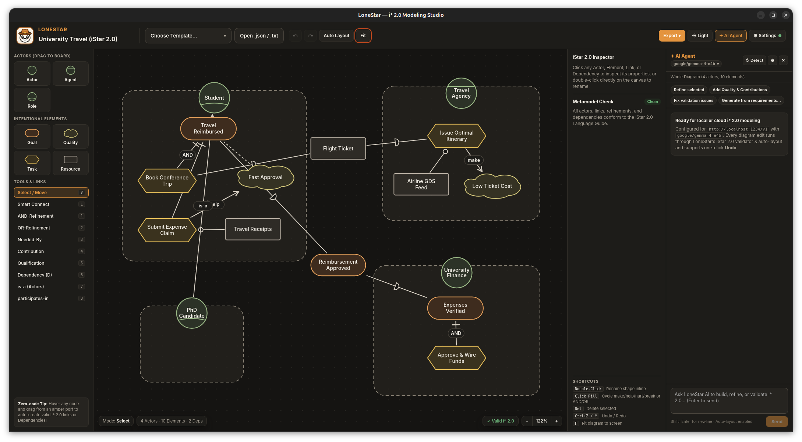
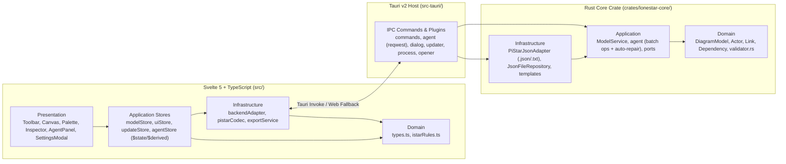

<div align="center">
  
  <h1>LoneStar</h1>
  <p>
    <strong>Native cross-platform iStar 2.0 (i*) requirements modeling studio built with Rust, Tauri v2, and Svelte 5.</strong>
  </p>

  <p>
    <a href="https://vinello28.github.io/lonestar/"><strong>🌐 Website & Downloads</strong></a>
    ·
    <a href="https://vinello28.github.io/lonestar/demo/index.html"><strong>⚡ Live Web Studio</strong></a>
    ·
    <a href="https://github.com/Vinello28/lonestar/releases"><strong>📦 Releases</strong></a>
    ·
    <a href="#clean-architecture"><strong>🧱 Architecture</strong></a>
  </p>

  

  <p>
    
    
    
    
    
    
    
    
    <a href="./LICENSE"></a>
  </p>
</div>

---

## Why LoneStar?

**LoneStar** is a fast, deterministic desktop and web modeling studio for medium-to-large Software Engineering $i^*$ sessions — built to complement the **piStar 2.0** ecosystem with native performance, real-time metamodel guidance, and seamless bidirectional `.json`/`.txt` interoperability.

- **Zero-Code Drag & Drop Board**: Drag Actors (`Actor`, `Agent`, `Role`) and Intentional Elements (`Goal`, `Quality`, `Task`, `Resource`) from the palette onto an infinite pan/zoom SVG canvas with 60fps native rendering and 60-step Undo/Redo history.
- **Smart Auto-Connect & Live Metamodel Validation**: Drag directly from element connection handles — LoneStar infers valid iStar 2.0 link types (auto-orienting `NeededBy`, detecting cross-boundary social `Dependency` links, and rejecting cycles or invalid pairings before creation).
- **Bidirectional piStar 2.0 Interoperability (`.json` & `.txt`)**: Open and export both native LoneStar JSON and piStar 2.0 `.json` / `.txt` files (including piStar's JSON-in-`.txt` exports and structured iStar text notation) via native file dialogs or drag-and-drop onto the canvas.
- **Publication-Grade Exports**: Render crisp High-DPI PNGs (`2x`, `3x`, `4x`, opaque or transparent background) using pure SVG `<text>`/`<tspan>` wrapping, plus standalone **Vector SVG 1.1** (resolving CSS `var(--...)` and `rgba(...)` paints to native hex + opacity attributes and stripping editor hit-targets for Inkscape/Illustrator/LaTeX compatibility).
- **Warm Non-Bluish Light & Dark Modes**: Carefully tuned **Alabaster Light** and **Obsidian Dark** palettes enforcing `R >= G >= B` across every surface background color (automatically verified in tests).
- **In-App Local & Cloud AI Agent (Desktop Only)**: Built-in modeling co-pilot powered by OpenAI-compatible local runtimes (**LM Studio**, **Ollama**) or cloud APIs (**OpenAI**, **OpenRouter**, **Custom**) with automatic iStar 2.0 metamodel repair, self-correction, and single-snapshot Undo/Redo.
- **Desktop Auto-Updater**: Built-in `tauri-plugin-updater` startup check and Settings modal displaying version metadata, download progress, OS-targeted release checks, and direct links to releases.

---

## Clean Architecture

Both the Rust workspace (`crates/lonestar-core`, `src-tauri`) and the Svelte 5 TypeScript application (`src/`) strictly follow **Clean Architecture** dependency rules:



### Repository Structure

```text
lonestar/
├── crates/lonestar-core/       # Pure Rust Clean Architecture domain, validation & interop crate
│   ├── src/domain/             # Entities, metamodel error types & formal validator (DFS cycles, constraints)
│   ├── src/application/        # ModelService (CRUD, auto-layout, stats), AI batch engine (agent.rs) & ports
│   ├── src/infrastructure/     # PiStarJsonAdapter (.json / .txt), file repository, built-in templates
│   └── tests/                  # Rust integration & AI agent repair test suite
├── src-tauri/                  # Tauri v2 desktop binary, AI HTTP orchestrator (src/agent.rs), updater config & icons
├── src/                        # Svelte 5 Runes + TypeScript frontend
│   ├── domain/                 # Client-side types, real-time rule checks & Smart Auto-Connect
│   ├── application/            # Reactive $state/$derived stores (Model, UI, Auto-Updater, AI Agent)
│   ├── infrastructure/         # Tauri/Web adapter, piStar .json/.txt codec, PNG/SVG exporter
│   └── presentation/           # Canvas, Toolbar, Palette, Inspector, AgentPanel, DependencyModal, SettingsModal
├── docs/                       # GitHub Pages website & compiled Web Studio (docs/demo/)
├── tests/                      # Vitest test suite (rules, interop, export bounds, SVG, AI store, CSS R>=G>=B)
└── .github/workflows/          # CI tests (Linux/macOS/Windows), GitHub Releases & GitHub Pages
```

---

## iStar 2.0 Metamodel Support

| Category | Supported Constructs | Enforced Rules |
| --- | --- | --- |
| **Actors** | `Actor`, `Agent`, `Role` | Expandable/collapsible SR boundaries; elements automatically attach/detach when dragged across boundaries |
| **Intentional Elements** | `Goal`, `Quality`, `Task`, `Resource` | Official iStar 2.0 geometry (pill, cloud curve, hexagon, rectangle) with auto-wrapped pure SVG labels |
| **Actor Links** | `IsA`, `ParticipatesIn` | `IsA` restricted to same-kind `Role → Role` or `Actor → Actor`; single structural link per actor pair; no is-a cycles and no participates-in cycles (checked per kind) |
| **SR Internal Links** | `AndRefinement`, `OrRefinement`, `NeededBy`, `Contribution` (`make`/`help`/`hurt`/`break`), `Qualification` | Same-boundary enforcement, acyclicity on refinements, `Resource → Task` (`NeededBy`), `* → Quality` (`Contribution`), `Quality → Goal/Task/Resource` (`Qualification`) |
| **Social Dependencies** | `Dependency` (Depender, Dependum, Dependee) | Validated distinct actor ownership for depender and dependee, element-actor containment, `D` semicircle markers |

### Keyboard Shortcuts

| Shortcut | Action |
| --- | --- |
| `V` | Select / Move mode |
| `L` | Smart Auto-Connect link mode |
| `1` – `8` | Direct link tools (`And`, `Or`, `NeededBy`, `Contribution`, `Qualification`, `Dependency`, `IsA`, `ParticipatesIn`) |
| `F` / `0` | Fit diagram to screen / Reset zoom & pan |
| `Space` + Drag | Pan canvas |
| `Ctrl/Cmd + Z` / `Y` | Undo / Redo (up to 60 steps) |
| `Ctrl/Cmd + S` | Save: overwrites the open LoneStar JSON file; asks where to save for a new diagram, a piStar / `.txt` source, or in the Web Studio (download). An **Unsaved** badge next to the title marks unsaved changes |
| `Ctrl/Cmd + Shift + S` | Save As LoneStar JSON |

The **Save** button next to *Open* does the same as `Ctrl/Cmd + S` and turns orange while there are unsaved changes. Closing with unsaved changes asks for confirmation first: the window (red button, `Cmd + W`, `Alt + F4`, and on macOS `Cmd + Q`, whose menu item is replaced so it closes the window instead of terminating the app) and the browser tab in the Web Studio.
| `Delete` / `Backspace` | Delete selected Actor, Element, Link, or Dependency |
| `Double-click` | Inline rename any Actor, Element, or Dependum |

---

## In-App Local & Cloud AI Agent (Desktop Only)

In the native Tauri v2 desktop app (strictly guarded by `isTauriRuntime()` so the Web Studio remains static and zero-backend), LoneStar provides an embedded **AI Modeling Co-Pilot** accessible via the **✦ AI Agent** panel and configured in **Settings**:

- **Supported Provider Presets** ([`agentStore.svelte.ts`](./src/application/agentStore.svelte.ts)):
  - **LM Studio (Local)**: `http://localhost:1234/v1` (default model: `google/gemma-4-e4b`)
  - **Ollama (Local)**: `http://localhost:11434/v1` (default model: `gemma4:e4b`)
  - **OpenAI (Cloud)**: `https://api.openai.com/v1` (default model: `gpt-4o`)
  - **OpenRouter (Cloud)**: `https://openrouter.ai/api/v1` (default model: `google/gemini-2.5-pro`)
  - **Custom**: Any OpenAI-compatible `/v1/chat/completions` & `/v1/models` endpoint
- **Declarative Batch Engine & Auto-Repair** ([`crates/lonestar-core/src/application/agent.rs`](./crates/lonestar-core/src/application/agent.rs)):
  - Resolves actors and elements by ID or case-insensitive name, applies batched graph mutations, and runs `ModelService::auto_layout`.
  - Automatically repairs common small-LLM iStar 2.0 mistakes (e.g., flipping reversed `NeededBy`, `Qualification`, and `Contribution` links, converting invalid `Agent` `IsA` links into `ParticipatesIn`, and promoting cross-boundary SR links into social `Dependency` links).
- **Resilient Orchestration & Undo/Redo** ([`src-tauri/src/agent.rs`](./src-tauri/src/agent.rs)):
  - Uses the OpenAI `apply_istar_operations` tool schema with automatic HTTP `400`/`422` non-tool fallback to fenced ` ```istar-ops ` / ` ```json ` blocks for local Jinja templates.
  - Runs up to **2 self-correction rounds** if any operation fails schema or metamodel validation, and commits the resulting diagram to `modelStore` as a single atomic Undo/Redo snapshot.

---

## Getting Started

### Prerequisites

- **Rust** (`stable`, tested with `1.90+`) + Cargo
- **Node.js** (`v22+`) & `npm`
- **Linux system libraries** (for native Tauri GTK/WebKit builds on Ubuntu/Debian):
  ```bash
  sudo apt-get update && sudo apt-get install -y \
    libwebkit2gtk-4.1-dev libappindicator3-dev librsvg2-dev patchelf
  ```

### Development & Verification

```bash
# 1. Install frontend dependencies
npm install

# 2. Run in Web Studio mode (Vite dev server)
npm run dev

# 3. Run in Native Desktop mode (Tauri v2 + Rust core)
npm run tauri dev

# 4. Run full verification suite (Rust + TypeScript + Vitest + Production build)
cargo fmt --all -- --check
cargo clippy --workspace --all-targets -- -D warnings
cargo test --workspace
npm run check
npm test
npm run build
```

---

## CI/CD & Auto-Updater Releases

- **Continuous Integration ([`.github/workflows/ci.yml`](./.github/workflows/ci.yml))**: Runs `tsc`, `vitest`, `vite build`, `cargo test --workspace`, and `cargo clippy -- -D warnings` on `ubuntu-22.04`, `macos-latest`, and `windows-latest`.
- **Cross-Platform Releases ([`.github/workflows/release.yml`](./.github/workflows/release.yml))**: Triggered on tags matching `v*` (or `workflow_dispatch`). Automatically syncs the `v*` tag version into `package.json`, `src-tauri/tauri.conf.json`, `Cargo.toml`, and `src-tauri/Cargo.toml`, builds cross-platform bundles (`.AppImage`, `.deb`, `.dmg` + `.app.tar.gz` for `aarch64`/`x86_64`, `.msi`, `.nsis`), and publishes `latest.json` for `tauri-plugin-updater`.
  - macOS bundles use `bundle.macOS.signingIdentity: "-"` in [`src-tauri/tauri.conf.json`](./src-tauri/tauri.conf.json) to seal `Info.plist` and bundle resources with a valid ad-hoc signature (`Contents/_CodeSignature`), allowing macOS users to open downloaded `.dmg` builds via **Privacy & Security → Open Anyway** without *"damaged"* bundle errors.
  - To enable signed auto-updates in GitHub Actions, set `TAURI_SIGNING_PRIVATE_KEY` (and optional `TAURI_SIGNING_PRIVATE_KEY_PASSWORD`) under **Settings → Secrets and variables → Actions** matching `plugins.updater.pubkey` in [`src-tauri/tauri.conf.json`](./src-tauri/tauri.conf.json).
  - If `TAURI_SIGNING_PRIVATE_KEY` is absent or empty (e.g., on community forks), the workflow automatically disables `bundle.createUpdaterArtifacts` and `includeUpdaterJson` so standard installer builds still succeed.
- **GitHub Pages ([`.github/workflows/pages.yml`](./.github/workflows/pages.yml))**: Publishes [`docs/`](./docs) along with the compiled Web Studio in `docs/demo/` automatically on every push to `main`.

---

## License

Licensed under the [MIT License](./LICENSE) — Copyright © 2026 **Vinello28**.
