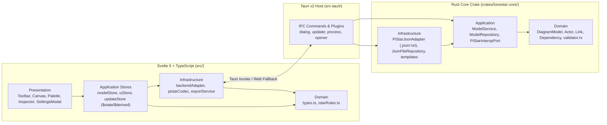

<div align="center">
  
  <h1>LoneStar</h1>
  <p>
    <strong>Native cross-platform iStar 2.0 (i*) requirements modeling studio built with Rust, Tauri v2, and Svelte 5.</strong>
  </p>

  <p>
    <a href="https://vinello28.github.io/lonestar/"><strong>🌐 Website & Downloads</strong></a>
    ·
    <a href="https://vinello28.github.io/lonestar/demo/index.html"><strong>⚡ Live Web Studio</strong></a>
    ·
    <a href="https://github.com/Vinello28/lonestar/releases"><strong>📦 Releases</strong></a>
    ·
    <a href="#clean-architecture"><strong>🧱 Architecture</strong></a>
  </p>

  <p>
    
    
    
    
    
    
    
    
    <a href="./LICENSE"></a>
  </p>
</div>

---

## Why LoneStar?

**LoneStar** was engineered as a fast, deterministic alternative to legacy browser-based $i^*$ editors (such as web piStar) that suffer from canvas lag, layout freezes, and brittle link handling during medium-to-large Software Engineering modeling sessions.

- **Zero-Code Drag & Drop Board**: Drag Actors (`Actor`, `Agent`, `Role`) and Intentional Elements (`Goal`, `Quality`, `Task`, `Resource`) from the palette onto an infinite pan/zoom SVG canvas with 60fps native rendering and 60-step Undo/Redo history.
- **Smart Auto-Connect & Live Metamodel Validation**: Drag directly from element connection handles — LoneStar infers valid iStar 2.0 link types (auto-orienting `NeededBy`, detecting cross-boundary social `Dependency` links, and rejecting cycles or invalid pairings before creation).
- **Bidirectional piStar 2.0 Interoperability (`.json` & `.txt`)**: Open and export both native LoneStar JSON and piStar 2.0 `.json` / `.txt` files (including piStar's JSON-in-`.txt` exports and structured iStar text notation) via native file dialogs or drag-and-drop onto the canvas.
- **Publication-Grade Exports**: Render crisp High-DPI PNGs (`2x`, `3x`, `4x`, opaque or transparent background) using pure SVG `<text>`/`<tspan>` wrapping, plus standalone Vector SVG.
- **Warm Non-Bluish Light & Dark Modes**: Carefully tuned **Alabaster Light** and **Obsidian Dark** palettes enforcing `R >= G >= B` across every surface background color (automatically verified in tests).
- **Desktop Auto-Updater**: Built-in `tauri-plugin-updater` startup check and Settings modal displaying version metadata, download progress, OS-targeted release checks, and direct links to releases.

---

## Clean Architecture

Both the Rust workspace (`crates/lonestar-core`, `src-tauri`) and the Svelte 5 TypeScript application (`src/`) strictly follow **Clean Architecture** dependency rules:



### Repository Structure

```text
lonestar/
├── crates/lonestar-core/       # Pure Rust Clean Architecture domain, validation & interop crate
│   ├── src/domain/             # Entities, metamodel error types & formal validator (DFS cycles, constraints)
│   ├── src/application/        # ModelService (CRUD, auto-layout, stats) & outbound ports
│   ├── src/infrastructure/     # PiStarJsonAdapter (.json / .txt), file repository, built-in templates
│   └── tests/                  # Rust integration test suite
├── src-tauri/                  # Tauri v2 desktop binary, capabilities, updater config & icons
├── src/                        # Svelte 5 Runes + TypeScript frontend
│   ├── domain/                 # Client-side types, real-time rule checks & Smart Auto-Connect
│   ├── application/            # Reactive $state/$derived stores (Model, UI, Auto-Updater)
│   ├── infrastructure/         # Tauri/Web adapter, piStar .json/.txt codec, PNG/SVG exporter
│   └── presentation/           # Canvas, Toolbar, Palette, Inspector, DependencyModal, SettingsModal
├── docs/                       # GitHub Pages website & compiled Web Studio (docs/demo/)
├── tests/                      # Vitest test suite (rules, interop, export bounds, CSS R>=G>=B check)
└── .github/workflows/          # CI tests (Linux/macOS/Windows), GitHub Releases & GitHub Pages
```

---

## iStar 2.0 Metamodel Support

| Category | Supported Constructs | Enforced Rules |
| --- | --- | --- |
| **Actors** | `Actor`, `Agent`, `Role` | Expandable/collapsible SR boundaries; elements automatically attach/detach when dragged across boundaries |
| **Intentional Elements** | `Goal`, `Quality`, `Task`, `Resource` | Official iStar 2.0 geometry (pill, cloud curve, hexagon, rectangle) with auto-wrapped pure SVG labels |
| **Actor Links** | `IsA`, `ParticipatesIn` | `IsA` restricted to same-kind `Role → Role` or `Actor → Actor`; single structural link per actor pair; cycle prevention |
| **SR Internal Links** | `AndRefinement`, `OrRefinement`, `NeededBy`, `Contribution` (`make`/`help`/`hurt`/`break`), `Qualification` | Same-boundary enforcement, acyclicity on refinements, `Resource → Task` (`NeededBy`), `* → Quality` (`Contribution`), `Quality → Goal/Task/Resource` (`Qualification`) |
| **Social Dependencies** | `Dependency` (Depender, Dependum, Dependee) | Validated distinct actor ownership for depender and dependee, element-actor containment, `D` semicircle markers |

### Keyboard Shortcuts

| Shortcut | Action |
| --- | --- |
| `V` | Select / Move mode |
| `L` | Smart Auto-Connect link mode |
| `1` – `8` | Direct link tools (`And`, `Or`, `NeededBy`, `Contribution`, `Qualification`, `Dependency`, `IsA`, `ParticipatesIn`) |
| `F` / `0` | Fit diagram to screen / Reset zoom & pan |
| `Space` + Drag | Pan canvas |
| `Ctrl/Cmd + Z` / `Y` | Undo / Redo (up to 60 steps) |
| `Delete` / `Backspace` | Delete selected Actor, Element, Link, or Dependency |
| `Double-click` | Inline rename any Actor, Element, or Dependum |

---

## Getting Started

### Prerequisites

- **Rust** (`stable`, tested with `1.90+`) + Cargo
- **Node.js** (`v22+`) & `npm`
- **Linux system libraries** (for native Tauri GTK/WebKit builds on Ubuntu/Debian):
  ```bash
  sudo apt-get update && sudo apt-get install -y \
    libwebkit2gtk-4.1-dev libappindicator3-dev librsvg2-dev patchelf
  ```

### Development & Verification

```bash
# 1. Install frontend dependencies
npm install

# 2. Run in Web Studio mode (Vite dev server)
npm run dev

# 3. Run in Native Desktop mode (Tauri v2 + Rust core)
npm run tauri dev

# 4. Run full verification suite (Rust + TypeScript + Vitest + Production build)
cargo fmt --all -- --check
cargo clippy --workspace --all-targets -- -D warnings
cargo test --workspace
npm run check
npm test
npm run build
```

---

## CI/CD & Auto-Updater Releases

- **Continuous Integration ([`.github/workflows/ci.yml`](./.github/workflows/ci.yml))**: Runs `tsc`, `vitest`, `vite build`, `cargo test --workspace`, and `cargo clippy -- -D warnings` on `ubuntu-22.04`, `macos-latest`, and `windows-latest`.
- **Cross-Platform Releases ([`.github/workflows/release.yml`](./.github/workflows/release.yml))**: Triggered on tags matching `v*`. Builds signed installers (`.AppImage`, `.deb`, `.dmg` for `aarch64`/`x86_64`, `.msi`, `.nsis`) and publishes the `latest.json` updater manifest consumed by `tauri-plugin-updater`.
  - To enable signed auto-updates in GitHub Actions, set `TAURI_SIGNING_PRIVATE_KEY` (and optional `TAURI_SIGNING_PRIVATE_KEY_PASSWORD`) under **Settings → Secrets and variables → Actions** matching the public key configured in [`src-tauri/tauri.conf.json`](./src-tauri/tauri.conf.json).
- **GitHub Pages ([`.github/workflows/pages.yml`](./.github/workflows/pages.yml))**: Publishes [`docs/`](./docs) along with the compiled Web Studio in `docs/demo/` automatically on every push to `main`.

---

## License

Licensed under the [MIT License](./LICENSE) — Copyright © 2026 **Vinello28**.
